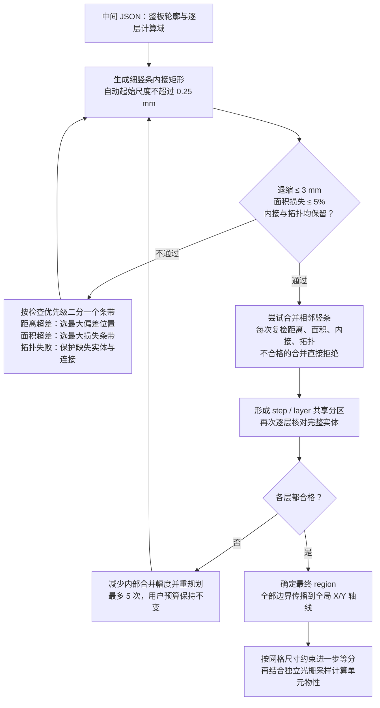

# Region 精度：轮廓距离与面积损失

2026-10-28。当前策略为 `inscribed-vertical-staircase-worst-first`。竖条直接使用整个 X 区间内共同存在的真实 Y 区间，构造和合并均不再使用 Y 量化格点。默认完整轮廓退缩量 **3 mm**、面积损失比例 **5%** 保持不变。

## 两个用户参数

```powershell
uv run --all-extras pcbeq run out/kicad-video-odb.tgz/pcbkit/intermediate.json -o out/kicad-video-odb.tgz/pcbeq --max-boundary-retreat-mm 3 --max-area-loss-ratio 0.05
```

| 参数 | 默认值 | 含义 |
|---|---|---|
| `--max-boundary-retreat-mm` | 3 mm | 原始实体与内接模型对应轮廓之间的双向欧氏距离上限，有限正数 |
| `--max-area-loss-ratio` | 0.05 | 损失面积 / 原始有效域面积的上限，范围 `[0,1)`，0.01 表示 1% |

两者同时约束 step profile 和每个待等效层的有效域（layer profile AND 原始 step profile）。
不再用绝对面积下限放宽小板的比例预算。零损失可用于精确轴对齐板型；有限轴对齐矩形不能精确表达真正的斜边，零损失时明确失败。

`tools/run_pipeline.py` 和 `tools/sync_out.py` 也接收并传递这两个参数；批量缓存把两者纳入请求指纹。
原来的隐藏面积比例/绝对面积命令行参数退役。隐藏 `--diagnostic-geometry-step-mm` 只覆盖内部初始种子尺度，不能代替误差预算。

## 当前算法示意图



图中 3 mm 是完整对应轮廓的双向欧氏距离上限，不是仅 Y 向退缩；起始尺度不是用户误差参数。
光栅 `Px/Py` 不进入几何规划。达到内部资源限制或重规划仍不合格时，报错停止，不生成成功结果。

## 真实 Y 区间

对于 X 条带 `[a,b]`，一个连续实体截面的下限是该条带内下边界的最大值，上限是上边界的最小值；孔洞会把截面分成多个区间，必须分别处理。
例如下边界从 1.2 mm 上升到 1.5 mm、上边界从 5.7 mm 下降到 4.8 mm，则完整条带的内接矩形使用 `[1.5,4.8]`，不再按某个步长向内取整。

实现将条带按真实轮廓 X 顶点分成线性边事件区间，直接求每段两端的单侧精确极限，再逐区间求交。每段必须先匹配连续的实体区间，再跨事件求交，不能仅对两个端点的实体并集取交：移动的凹孔可能在中间穿过两端看似都有实体的位置。
派生的 step/layer 相交域、矩形并集也保留实际浮点坐标，不再重新经过整数几何内核量化。
孔洞对应关系的包含谓词仅容许 32 ULP 的坐标舍入误差，不修改任何顶点，不把它作为物理误差预算。

## 距离检查的几何含义

先对实际矩形集合求并集，再与原始有效域比较，因此矩形间的内部接缝不算轮廓。
外轮廓按所属实体一一对应，profile 孔洞按包含关系一一对应；不能让某个孔的边界错误地匹配到附近板边。
每对轮廓都检查原始 → 模型、模型 → 原始两个方向。DRILL 不参加轮廓规划，它仍是介质采样中的实心铜图案。

检查完整线段是否被对方轮廓的距离管带覆盖，而非只检查顶点或 Y 向退缩。
圆角管带使用内接多边形近似（每象限 32 段），因此通过覆盖检查给出保守的连续距离保证；圆角近似可能多拒绝少量临界候选，不会放宽给定预算。
GEOS 的离散 Hausdorff 值只用作下界和快速拒绝，不能据此接受候选。
最终距离上界通过管带半径二分得到，二分半径分辨率为 `max(1e-9 mm, ε × 0.001)`。
输出的下界仍是顶点距离下界，并不宣称上下界间隔都达到该分辨率。

## 最差位置优先细化

1. 用物理尺寸建立竖条种子；自动初始尺度为 `min(max(0.5 mm, 整板短边 / 32), ε / 2, 0.25 mm)`。
   放宽默认距离到 3 mm 后保留原先 0.25 mm 的细种子上限，避免刚挠层域粗种子触发拓扑失败；后续合并仍可以使用完整的 3 mm 预算。该上限只是内部起始尺度，不是额外的误差参数。
   同一 step 的层域共用 X 基础；没有 Y 原点或 Y 取整尺度。轴对齐轮廓按真实 X 顶点精确分条。
   初始尺度只是降低迭代成本的种子，不能作为误差合格的依据。
2. 每轮重建内接矩形的并集，检查真实外轮廓和孔洞边界。
3. 距离超差时，通过接近最大偏差的连续管带残余片段定位最差位置，优先二分其所属竖条；数值定位精度与距离二分分辨率一致。
   同一位置落在相邻条带公共边时，优先选损失面积较大的相邻条带。残余片段必须分别处理，禁止在不相连片段间生成虚假的中点。
4. 距离通过后，如果总面积仍超预算，优先细化损失贡献最大的条带。
5. 面积和距离都通过后继续检查岛、孔、正宽连接和内部保护核。拓扑失败时优先修复没有建模实体的条带；其余按损失贡献细化。

切片的人为截面边不参与轮廓距离。仅计算单个切片轮廓会在陡边附近产生假超差，甚至导致无限缩小条带而无法解决真正误差。
每轮的原因、选中区间、最差位置、距离上界和面积损失写入 `audit.local_refinement`。

## 合并与逐层共享分区

先合并真实 Y 区间完全一致的相邻矩形；一个条带内其他区间不同，不妨碍合并其中相同的区间。
随后尝试取相邻条带的共同区间，保留不能一一匹配的其他实体区间。目标是减少传播至全板的 X/Y 强制轴线，其次减少 region 数。
任何会改变实体的候选都重查面积、连续距离、内接与拓扑；批量不通过时逐个检查，不能消费面积预算来突破局部距离约束。
小规模距离管带缓存以完整不可变几何与物理半径为键，不依赖光栅。

共享分区后再进行相邻条带的受约束合并：将同一 X 范围中上下相接的分区作为候选截面，尝试共同上下限，或仅共享一侧限制边界。
只共享一侧时可能只减少全局强制轴线，不直接减少矩形数；另一侧仍保持原真实边界。这样不必为消除一个很小的下边界差异而强行截掉另一侧大量实体。
候选下限只能升高、上限只能降低，采用的值来自相邻条带真实端点；没有固定或自适应 Y 格点，也不按小数位取整。
不同层成员身份保留必要的 X 接缝，每个受影响层都单独复检。相同成员身份且几何边界完全相接的矩形才进行无损合并。

内部合并优先处理相距不足 0.1 mm 的强制轴线，以每消除一处密集轴线所需的面积损失排序，再减少其他轴线和 region。这是几何候选的排序偏好，不是 Y 量化步长或硬性最小尺寸；不读取光栅参数。
共享阶段最多接受 256 次候选，达到上限仍保留已经满足误差预算的模型，不宣称达到全局最少分区。
没有任何待等效物理层存在的 step 参考分区不输出实体；清理该类分区前后逐层实体并集保持不变。根模型面积以待等效物理域并集为基准，完整 step 参考模型的面积与损失另行记录，光栅范围仍取原始完整 step。

step / layer 模型相交并共享分区后，对每个原始有效域再次完整检查两预算与拓扑。
若只有共享层域复检失败，保持用户距离和面积预算不变，逐次减少各域独立预合并的幅度并重新规划；最多尝试原合并上限及其 1/2、1/4、1/8、1/16。最终共享分区候选仍按完整用户预算复检。各次预合并上限、失败层域和结果写入 `audit.shared_domain_replanning`，采用的内部预合并上限写入 `coarsening_retreat_limit_mm`。这是自动局部保护策略，不增加用户参数，也不放宽约束。其他几何错误不通过重试掩盖。
仍失败时给出具体 domain 和超差数据，不生成可被误认为成功的 MaterialMap。
当前算法是受约束的启发式，不承诺最少矩形数，也不承诺在所有可解的多域问题上都找到方案。

## 网格、光栅与终止限制

region 的所有边界继续传播到全局笛卡尔栅；物性网格尺寸按各相邻强制区间独立等分。
`Px/Py` 只影响随后材料采样。收紧几何误差会增加强制轴线和单元数，也可能触发默认光栅的容量上限。
最小单元尺寸约束现已删除；实际短区间保留，显式光栅不足仍报错，不回头修改几何。

内部资源限制：初始条带最多 10,000 条；逐次二分最多 10,000 次；单条带最多二分 20 层；独立域预合并最多 12 轮，共享分区最多接受 256 次候选；
最小 X 条带宽度为 `1e-5 mm`，Y 不设量化尺度。小于数值区间阈值（`1e-8 mm`）的截面不作为正宽区间；任何因此造成的实体、孔洞或连接丢失仍必须被拓扑检查拒绝。这些是资源/数值终止条件，并非可保证保留任意微小特征的物理精度。
到达限制仍不合格时，诊断含 X 区间、长度、当前尺度、距离预算及迭代限制。
内接面积检查继续采用 `1e-8 mm²` 数值容差，不能把它用作物理面积损失预算。

## 输出与验证

`diagnostics/run.json` 和 `regions/regions.stats.json` 保留两预算、连续距离上界、逐次细化历史、
合并拒绝原因、每域共享分区后的复检结果。region 图显示距离预算、实际距离上界和面积损失。

```powershell
uv run --all-extras pytest
uv run --all-extras python tools/validate_region_accuracy.py --output docs/equivalence/no-y-quantization-validation.json
uv run --all-extras python tools/validate_region_accuracy.py --output docs/equivalence/region-accuracy-default-3mm-validation.json
uv run --all-extras python tools/validate_region_accuracy.py --case kicad-video-odb.tgz --max-boundary-retreat-mm 0.25 --max-area-loss-ratio 0.01 --diagnostic-geometry-step-mm 1 --output docs/equivalence/region-accuracy-tight-validation.json
uv run --all-extras python tools/validate_region_accuracy.py --case kicad-video-odb.tgz --sampling-convergence --output docs/equivalence/region-sampling-validation.json
uv run --all-extras python tools/sync_out.py --force-equivalent
uv run --all-extras python tools/audit_out.py
```

原 0.5 mm 默认值的真实案例对照见 `region-accuracy-validation.json`，当前默认值见 `region-accuracy-default-3mm-validation.json`，收紧预算见
`region-accuracy-tight-validation.json`。默认对照同时逐一核对 4096² 和 8192² 两种光栅输入下的 region、全局 X/Y 轴线完全一致；该项只运行几何规划，材料采样容量由完整 CLI 和逐单元输出审计另行验证。
耗时包含几何规划和网格生成，前后均开启 tracemalloc；Python 分配峰值不包含 GEOS/NumPy 的原生内存，不应误读为进程峰值。

原 0.5 mm 默认策略的初始种子已经可能满足两项预算，所以该次三种真实案例默认运行的细化次数均为 0；之后仍对每次简化复检。
收紧预算的 video 验证专门覆盖较粗的内部种子，实际执行 391 次最差位置细化，最终距离上界 0.249608 mm、面积损失 0.347992%。该内部种子覆盖仅为验证细化路径，不是第三个用户精度参数。

材料采样对照见 `region-sampling-validation.json`。
video 默认 5621×1921 与双倍 11242×3842 的 35,861 个完整三维单元坐标全部相同；
kx/ky 的第 95 百分位相对变化约为 12.34% / 12.10%。细走线和接近纯 FR4 的单元仍有很大的相对差异，
因此该对照验证了几何独立性并量化采样变化，不能宣称所有单元的物性都已收敛。几何距离预算不承担材料采样误差保证。

## 历史策略对照

旧策略基线提交为 `6e66c70`；下表记录调整默认值之前的 0.5 mm / 5% 验证结果，作为历史对照保留。下表误差为 step profile，逐层域检查结果见 JSON 报告。

| case | region 前→后 | XY 单元前→后 | 距离上界前→后 mm | 面积损失前→后 | 几何与网格秒前→后 | Python 分配峰值 MiB 前→后 |
|---|---:|---:|---:|---:|---:|---:|
| kitchen-sink | 78→566 | 4,217→129,818 | 4.04113→0.5 | 4.9971%→0.6895% | 1.212→39.641 | 7.72→42.49 |
| video | 6→26 | 3,441→5,123 | 13.34764→0.471983 | 4.9267%→0.3868% | 0.785→1.403 | 0.97→2.07 |
| 刚挠板 | 45→127 | 4,262→10,443 | 2.25419→0.5 | 4.9851%→1.9655% | 1.948→12.093 | 2.45→3.90 |

更严格的局部距离约束明显增加 kitchen-sink 的轴线和计算量；当前策略不以牺牲误差预算换取旧版规模。
这些是本机单次测量，运行期间存在其他验证进程，不应作为性能承诺。
19 个案例的正式 MaterialMap、掩膜、热图和几何图已更新到 `out/`，
逐单元审计见 `output-validation.json`。
0.5 mm 阶段完整回归 **817 项通过**（260.58 秒），当时 19 个案例共 **934,041 个三维物性单元**全部通过输出审计；当前 3 mm 的逐单元统计以 `output-validation.json` 为准。
新旧误差、耗时与 Python 分配峰值均保留在默认对照报告；新产物的 `published_run` 另记录含图像与 IO 的完整 CLI 耗时和原生进程峰值，不能与仅几何规划的测量混用。

保留 Y 量化时，3 mm / 5% 默认值的历史真实案例结果如下，均通过当时的逐层域、连续距离及 4096² / 8192² 几何坐标一致性检查：

| case | region | XY 单元 | 距离上界 mm | 面积损失 |
|---|---:|---:|---:|---:|
| kitchen-sink | 87 | 5,087 | 2.991501 | 4.0138% |
| video | 9 | 3,703 | 2.946072 | 1.7853% |
| 刚挠板 | 54 | 3,276 | 1.444181 | 4.6561% |

刚挠板共享层域自动重规划时缩小了内部合并幅度，因此实际退缩上界小于 3 mm；3 mm 是允许上限，不要求算法必须消耗完预算。完整记录见 3 mm 验证报告（`region-accuracy-default-3mm-validation.json`）。
本次默认值调整后的 86 项定向回归全部通过；19 个案例、362,746 个完整三维物性单元通过输出审计，最终掩膜、热图和几何图已按 3 mm 设置更新。

## 去除 Y 量化后的真实案例

对照基线为 `8b385cb` 的 3 mm / 5% 实现。当前几何与网格结果如下；距离列为完整对应轮廓的连续欧氏距离上界。

| case | region 前→后 | XY 单元前→后 | 当前距离上界 mm | 当前面积损失 |
|---|---:|---:|---:|---:|
| kitchen-sink | 87→74 | 5,087→8,719 | 2.963044 | 3.2311% |
| video | 9→10 | 3,703→3,755 | 2.837158 | 0.1874% |
| 刚挠板 | 54→32 | 3,276→4,102 | 2.690795 | 4.9637% |

region 减少不保证全局网格单元减少：真实非均匀边界仍需传播至全板，video 的启发式解也比历史量化方案多一个 region。
逐域距离、孔洞/连通性、完整 region/网格坐标独立于光栅，以及同口径几何耗时、Python 分配峰值见 `no-y-quantization-validation.json`。
当前完整输出及逐单元检查以 `output-validation.json` 为准；上文旧报告保留为历史证据，不代表当前几何。

完整回归 **830 项通过**（209.31 秒）；19 个 case 的 **399,858 个完整三维物性单元**通过输出审计。
掩膜、物性热图及实际 region 几何图已更新到 `out/`，默认光栅容量上限仍为 1.2 亿像素。

| case | 几何及网格秒 前→后 | Python 分配峰值 MiB 前→后 | 完整 CLI 秒 前→后 |
|---|---:|---:|---:|
| kitchen-sink | 4.720→26.643 | 8.45→3.34 | 11.305→19.308 |
| video | 1.254→1.814 | 1.26→1.09 | 7.337→7.961 |
| 刚挠板 | 10.843→83.035 | 3.05→5.44 | 31.663→66.637 |

这是本机单次测量，当前几何检查期间同时运行其他回归/输出任务；不能将不同口径的几何测量与 CLI 墙钟时间直接相比。
去掉 Y 格点后需要更多共同区间候选和逐层复检，尤其刚挠板更慢；当前没有最优 region 数或运行时间保证。

新策略的 收紧预算验证（`no-y-quantization-tight-validation.json`） 使用 video 真实轮廓、1 mm 内部 X 种子、0.25 mm / 1% 预算，实际执行 **36 次**最差位置细化，最终距离上界 0.222366 mm、面积损失 0.02818%。
材料采样对照（`no-y-quantization-sampling.json`） 将 video 默认 4096×1401 加密到 8192×2802，26,285 个完整三维单元的 region/单元坐标全部相同。
kx/ky 的第 95 百分位相对变化约 14.77% / 15.13%，局部差异仍可很大；这项检查证明采样不改变几何，并不宣称材料物性普遍收敛。

随后删除最小网格约束，并将档位最大尺寸估算固定使用原始 step 范围。
region 几何不变，部分全局网格数量因此变化；最新 19 个 case、398,124 个三维单元通过审计。
832 项完整回归通过，当前仅保留阶梯算法，网格设置与运行统计见 `max-grid-validation.json`。上文表格保留为该阶段历史对照。
