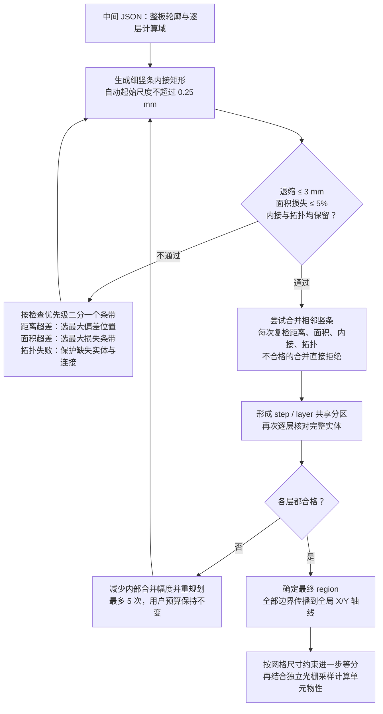

# 内接 region 与几何精度

## 决策与参数

| 参数 | 默认值 | 含义 |
|---|---|---|
| `--max-boundary-retreat-mm` | 3 mm | 原始实体与内接模型对应轮廓之间的双向欧氏距离上限，有限正数 |
| `--max-area-loss-ratio` | 0.05 | 损失面积 / 原始有效域面积的上限，范围 `[0,1)`，0.01 表示 1% |

两者同时约束 step profile 和每个待等效层的有效域（layer profile AND 原始 step profile）。
面积预算直接使用有效域面积乘以损失比例。零损失可用于精确轴对齐板型；有限轴对齐矩形不能精确表达真正的斜边，零损失时明确失败。

`tools/run_pipeline.py` 和 `tools/sync_out.py` 也接收并传递这两个参数；批量缓存把两者纳入请求指纹。
隐藏 `--diagnostic-geometry-step-mm` 只覆盖内部初始种子尺度，不能代替误差预算。

## 当前算法示意图

图中 3 mm 是完整对应轮廓的双向欧氏距离上限，不是仅 Y 向退缩；起始尺度不是用户误差参数。
光栅 `Px/Py` 不进入几何规划。达到内部资源限制或重规划仍不合格时，报错停止，不生成成功结果。

## 真实 Y 区间

对于 X 条带 `[a,b]`，一个连续实体截面的下限是该条带内下边界的最大值，上限是上边界的最小值；孔洞会把截面分成多个区间，必须分别处理。
例如下边界从 1.2 mm 上升到 1.5 mm、上边界从 5.7 mm 下降到 4.8 mm，则完整条带的内接矩形使用 `[1.5,4.8]`，直接采用真实 Y 上下限。

实现将条带按真实轮廓 X 顶点分成线性边事件区间，直接求每段两端的单侧精确极限，再逐区间求交。每段必须先匹配连续的实体区间，再跨事件求交，不能仅对两个端点的实体并集取交：移动的凹孔可能在中间穿过两端看似都有实体的位置。
派生的 step/layer 相交域、矩形并集保留实际浮点坐标。
孔洞对应关系的包含谓词仅容许 32 ULP 的坐标舍入误差，不修改任何顶点，不把它作为物理误差预算。

## 距离检查的几何含义

先对实际矩形集合求并集，再与原始有效域比较，因此矩形间的内部接缝不算轮廓。
外轮廓按所属实体一一对应，profile 孔洞按包含关系一一对应；不能让某个孔的边界错误地匹配到附近板边。
每对轮廓都检查原始 → 模型、模型 → 原始两个方向。DRILL 不参加轮廓规划，它仍是介质采样中的实心铜图案。

检查完整线段是否被对方轮廓的距离管带覆盖，而非只检查顶点或 Y 向退缩。
圆角管带使用内接多边形近似（每象限 32 段），因此通过覆盖检查给出保守的连续距离保证；圆角近似可能多拒绝少量临界候选，不会放宽给定预算。
GEOS 的离散 Hausdorff 值只用作下界和快速拒绝，不能据此接受候选。
最终距离上界通过管带半径二分得到，二分半径分辨率为 `max(1e-9 mm, ε × 0.001)`。
输出的下界仍是顶点距离下界，并不宣称上下界间隔都达到该分辨率。

## 最差位置优先细化

1. 用物理尺寸建立竖条种子；自动初始尺度为 `min(max(0.5 mm, 整板短边 / 32), ε / 2, 0.25 mm)`。
   0.25 mm 的细种子上限有助于避免刚挠层域的粗种子触发拓扑失败；后续合并仍可使用完整的退缩预算。该上限只是内部起始尺度，不是额外的误差参数。
   同一 step 的层域共用 X 基础；没有 Y 原点或 Y 取整尺度。轴对齐轮廓按真实 X 顶点精确分条。
   初始尺度只是降低迭代成本的种子，不能作为误差合格的依据。
2. 每轮重建内接矩形的并集，检查真实外轮廓和孔洞边界。
3. 距离超差时，通过接近最大偏差的连续管带残余片段定位最差位置，优先二分其所属竖条；数值定位精度与距离二分分辨率一致。
   同一位置落在相邻条带公共边时，优先选损失面积较大的相邻条带。残余片段必须分别处理，禁止在不相连片段间生成虚假的中点。
4. 距离通过后，如果总面积仍超预算，优先细化损失贡献最大的条带。
5. 面积和距离都通过后继续检查岛、孔、正宽连接和内部保护核。拓扑失败时优先修复没有建模实体的条带；其余按损失贡献细化。

切片的人为截面边不参与轮廓距离。仅计算单个切片轮廓会在陡边附近产生假超差，甚至导致无限缩小条带而无法解决真正误差。
每轮的原因、选中区间、最差位置、距离上界和面积损失写入 `audit.local_refinement`。

## 合并与逐层共享分区

先合并真实 Y 区间完全一致的相邻矩形；一个条带内其他区间不同，不妨碍合并其中相同的区间。
随后尝试取相邻条带的共同区间，保留不能一一匹配的其他实体区间。目标是减少传播至全板的 X/Y 强制轴线，其次减少 region 数。
任何会改变实体的候选都重查面积、连续距离、内接与拓扑；批量不通过时逐个检查，不能消费面积预算来突破局部距离约束。
小规模距离管带缓存以完整不可变几何与物理半径为键，不依赖光栅。

共享分区后再进行相邻条带的受约束合并：将同一 X 范围中上下相接的分区作为候选截面，尝试共同上下限，或仅共享一侧限制边界。
只共享一侧时可能只减少全局强制轴线，不直接减少矩形数；另一侧仍保持原真实边界。这样不必为消除一个很小的下边界差异而强行截掉另一侧大量实体。
候选下限只能升高、上限只能降低，采用的值来自相邻条带真实端点；没有固定或自适应 Y 格点，也不按小数位取整。
不同层成员身份保留必要的 X 接缝，每个受影响层都单独复检。相同成员身份且几何边界完全相接的矩形才进行无损合并。

内部合并优先处理相距不足 0.1 mm 的强制轴线，以每消除一处密集轴线所需的面积损失排序，再减少其他轴线和 region。这是几何候选的排序偏好，不是 Y 量化步长或硬性最小尺寸；不读取光栅参数。
共享阶段最多接受 256 次候选，达到上限仍保留已经满足误差预算的模型，不宣称达到全局最少分区。
没有任何待等效物理层存在的 step 参考分区不输出实体；清理该类分区前后逐层实体并集保持不变。根模型面积以待等效物理域并集为基准，完整 step 参考模型的面积与损失另行记录，光栅范围仍取原始完整 step。

step / layer 模型相交并共享分区后，对每个原始有效域再次完整检查两预算与拓扑。
若只有共享层域复检失败，保持用户距离和面积预算不变，逐次减少各域独立预合并的幅度并重新规划；最多尝试原合并上限及其 1/2、1/4、1/8、1/16。最终共享分区候选仍按完整用户预算复检。各次预合并上限、失败层域和结果写入 `audit.shared_domain_replanning`，采用的内部预合并上限写入 `coarsening_retreat_limit_mm`。这是自动局部保护策略，不增加用户参数，也不放宽约束。其他几何错误不通过重试掩盖。
仍失败时给出具体 domain 和超差数据，不生成可被误认为成功的 MaterialMap。
当前算法是受约束的启发式，不承诺最少矩形数，也不承诺在所有可解的多域问题上都找到方案。

## 网格、光栅与终止限制

region 的所有边界继续传播到全局笛卡尔栅；物性网格尺寸按各相邻强制区间独立等分。
`Px/Py` 只影响随后材料采样。收紧几何误差会增加强制轴线和单元数，也可能触发默认光栅的容量上限。
实际短区间保留，显式光栅不足仍报错，不回头修改几何。

内部资源限制：初始条带最多 10,000 条；逐次二分最多 10,000 次；单条带最多二分 20 层；独立域预合并最多 12 轮，共享分区最多接受 256 次候选；
最小 X 条带宽度为 `1e-5 mm`，Y 不设量化尺度。小于数值区间阈值（`1e-8 mm`）的截面不作为正宽区间；任何因此造成的实体、孔洞或连接丢失仍必须被拓扑检查拒绝。这些是资源/数值终止条件，并非可保证保留任意微小特征的物理精度。
到达限制仍不合格时，诊断含 X 区间、长度、当前尺度、距离预算及迭代限制。
内接面积检查继续采用 `1e-8 mm²` 数值容差，不能把它用作物理面积损失预算。

## 依据与实现对照

真实 Y 共同区间使矩形完整位于原始实体内；双预算同时控制局部轮廓偏差和总面积损失。
拓扑检查保护独立实体、孔洞和正宽连接，各实体及孔洞一一对应，孔洞保持与板外分离。
几何腐蚀半径 0.03125、0.1、0.25、0.5、1 mm 的局部实体核参与保护检查，防止小叶片和窄颈被总面积检查掩盖。

审计记录包含面积、内接、拓扑、连续距离上界、局部细化和共享域重规划结果。
`diagnostics/run.json` 与 `regions/regions.stats.json` 保存实际策略及检查结果；region 图显示实际采用的矩形集合。
资源限制内无法满足约束时停止并给出定位诊断。算法采用受约束启发式，结果不承诺全局最少矩形数。
网格规则见 [全局笛卡尔栅](global-cartesian-grid.md)。
