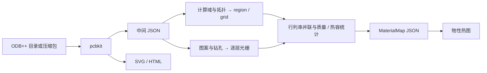

# 技术栈与架构

## 数据流

`pcbkit` 将 ODB++ 单板解析为毫米单位、极性规整后的中间 JSON，并生成 SVG / HTML。
`pcbeq` 独立读取 JSON：几何分支规划逐层完整 region 与全局网格，材料分支逐层光栅采样，两者在单元统计阶段汇合并输出 MaterialMap。

光栅控制材料采样；region 与网格由物理几何、误差预算和最大尺寸确定。

## 组件与职责

| 组件 | 技术 | 职责 |
| --- | --- | --- |
| ODB++ IO | Python 标准库 | tar/zip/gzip、记录文本与文件索引 |
| 解析器几何 | pyclipper、dataclass | 符号、扫掠、极性、正向拓扑与量化 |
| 中间接口 | Pydantic | JSON 类型、引用、层跨度和来源语义校验 |
| region 规划 | Shapely / GEOS | 简单 profile 的内接、连续距离与拓扑检查 |
| 采样与统计 | NumPy、扫描线 | 岛孔掩膜、逐行 / 逐列积分 |
| 图片 | Matplotlib Agg、PNG 编码器 | 三方向热图、region / 网格诊断与掩膜 |
| 离线查看器 | SVG、内联 HTML/CSS/JS | 图层、矩阵、缩放、测距与属性检查 |
| 开发与测试 | uv、pytest | 工作区依赖、回归与独立分发验证 |

准确依赖版本见 `uv.lock`；各产品运行依赖见各自 `pyproject.toml`。
解析器运行只依赖 Pydantic 与 pyclipper；等效器另用 Shapely、NumPy 和 Matplotlib。

## 模块入口

| 范围 | 模块 |
| --- | --- |
| 解析与来源 | `pcbkit.archive/textio/metadata/job/features/units` |
| 实体展开与 Z | `pcbkit.symbols/geometry/clipper/expand/stackup` |
| 解析交付与预览 | `pcbkit.export/drawing/svg/application/publication` |
| region 与网格 | `pcbeq.rectify/grid/mesh` |
| 材料与等效 | `pcbeq.materials/raster/equiv` |
| 等效交付与绘图 | `pcbeq.materialmap/visualize/plotting/application/publication` |
| 唯一契约源 | `contracts/intermediate.py` |
| 跨进程协同 | `tools/run_pipeline.py`、`tools/sync_out.py` |

两个包通过文件契约协作，各自携带同源生成的接口模型。阶段内部使用 dataclass 和数组，IO 边界使用 Pydantic。
架构理由见 [独立产品决策](decisions/independent-products.md)，字段见 [接口索引](interfaces/README.md)。
